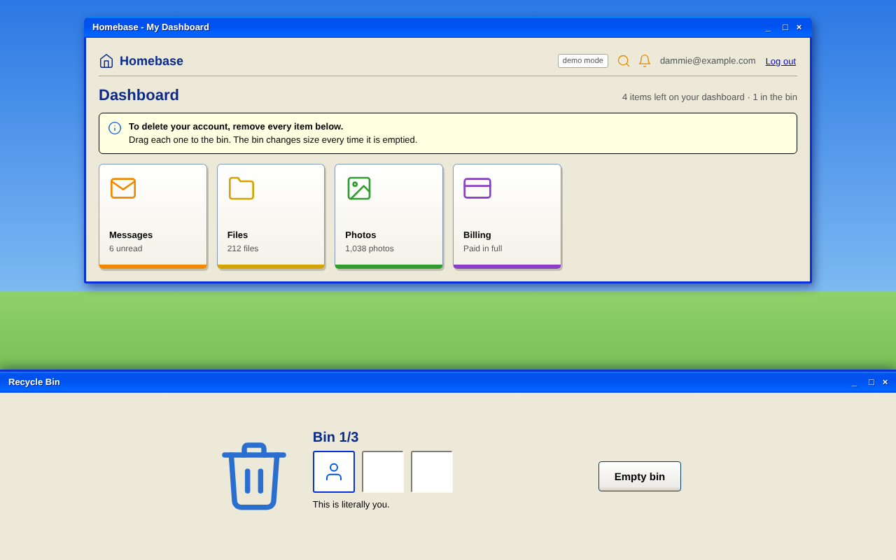
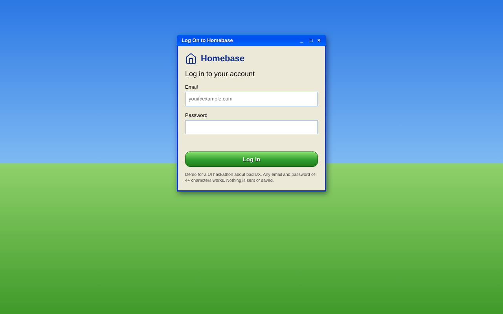
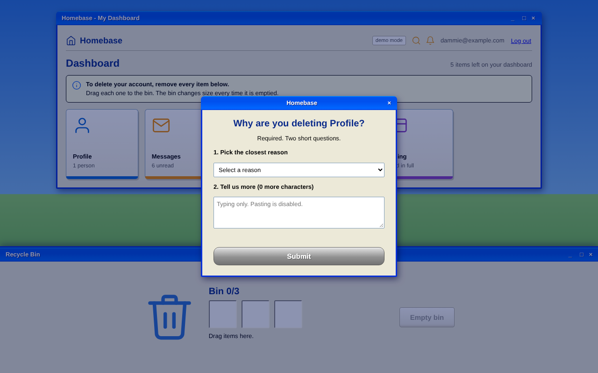
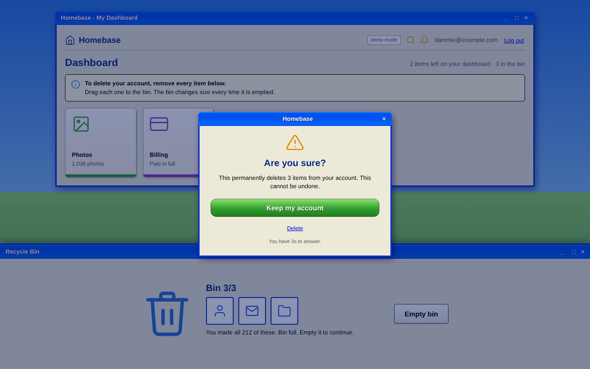
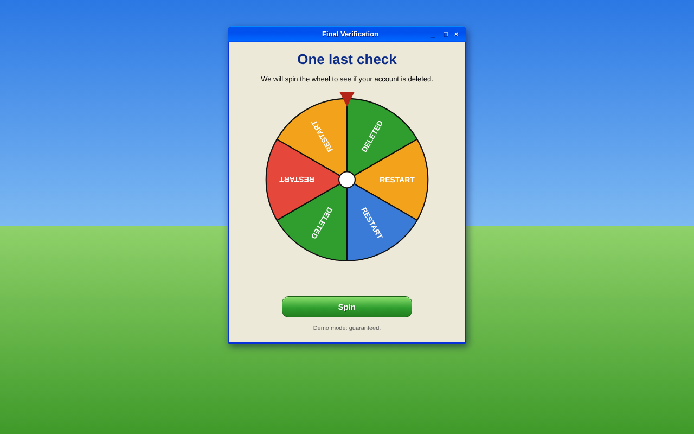

# Homebase

**A deliberately terrible account-deletion flow. Satire as a design critique.**

Homebase is a fake dashboard with one job: let you delete your account. To do it, you have to chase every tile around the screen, drag each one into a tiny bin, justify yourself, wait, answer a captcha, and finally spin a roulette wheel to find out whether the account is really gone.

Built for a university UI hackathon with the theme **"bad UX for deleting an account"**.



## The problem it addresses

Signing up takes one click. Leaving often takes a support ticket. Many products hide the delete option, bury it behind retention offers, guilt the user, and make the process slow enough that people give up. These are known as dark patterns, and they are easy to describe but hard to *feel*.

Homebase exaggerates each one until the intent is impossible to miss. The point is not that the interface is broken. The point is that every annoyance is a real, recognisable pattern turned up a few notches, so the audience laughs and then recognises it from an app they use.

## Concept

The dashboard is made of movable tiles (Profile, Messages, Files, Photos, Billing). There is no "Delete account" button that does the work. Deleting the account means deleting the dashboard, one tile at a time, by hand, using a recycle bin that is fixed to the bottom of the screen and refuses to cooperate.

Every irritation follows one rule: it should look like a legitimate UX pattern that has gone slightly wrong. Random chaos reads as a bug. A believable dark pattern reads as satire.

## User journey

1. **Log in.** Any email-shaped address and a password of 4+ characters works. Nothing is sent or stored.
2. **Click "Delete account".** A notice explains that every tile must be removed.
3. **Catch a tile.** Each tile dodges the cursor three times, then lets itself be caught.
4. **Drag it into the bin.** A rate limiter allows one deletion every 5 seconds.
5. **Explain yourself.** A required survey asks why you are deleting that tile, with a two-part answer and a first submission that is always rejected.
6. **Fill the bin.** It holds 1 to 3 items and changes size every time it is emptied. Now and then it disappears for a few seconds.
7. **Empty the bin.** A retention offer comes first, then an "Are you sure?" popup with swapping buttons and a 10-second window. Miss it and a captcha appears.
8. **Wait.** A 14-second progress bar climbs, falls back, stalls at 99%, and restarts.
9. **Repeat** until the dashboard is empty. Deleted tiles may reappear along the way.
10. **Spin the wheel.** Two segments in six delete the account. The rest send you back to the start.
11. **Celebrate.** Confetti and "Account deleted!", followed by "Just kidding, we saved your data. Log in to confirm deletion."

| Login | Reason survey |
| --- | --- |
|  |  |

| "Are you sure?" | Roulette |
| --- | --- |
|  |  |

## Features

**Interaction**
- Drag-and-drop tiles into a fixed, full-width bin using pointer events, so mouse, touch and pen all work.
- Fleeing tiles: each tile dodges the cursor three times, nearby tiles scatter, and every tile re-arms when the cursor moves away.
- A bin with 1 to 3 slots that resizes after each emptying and slides off screen at random.
- Respawning: after 15 seconds without progress, one deleted tile comes back with "Item restored for your convenience!"

**Dialogs and interruptions**
- Required reason survey per tile, with a reshuffling dropdown, a 30-character minimum, blocked pasting and a rejected "Reason not listed" option.
- Retention offer: "Stay for 3 months free", where claiming it cancels the whole deletion.
- "Are you sure?" popup whose Keep and Delete buttons swap places on hover, with a 10-second countdown.
- Captcha: spell "goodbye" backwards by clicking scrambled letters.
- Newsletter popup with a barely visible close button.
- Session expiry that rejects the first password attempt.

**Feedback**
- Fake progress bar with regressions and a "time left" label that changes its mind every second.
- Guilt copy for every tile ("This is literally you.").
- Roulette wheel with a 2-in-6 chance of success, drawn in SVG.
- Canvas confetti and a fake-success twist.

**Platform**
- Responsive layout with safe-area insets for phones.
- Honours `prefers-reduced-motion`.
- Demo mode (Shift+D), described below.

## Dark patterns it parodies

| Pattern | Where it appears |
| --- | --- |
| Roach motel (easy in, hard out) | The whole flow, and the roulette restart |
| Obstruction | Fleeing tiles, 1 to 3 slot bin, vanishing bin, rate limit |
| Forced action | Reason survey, captcha, session expiry |
| Confirmshaming | Guilt copy, "No thanks, I like paying" |
| Misdirection | Swapping Keep and Delete buttons, tiny greyed Delete link |
| Nagging | Newsletter popup, retention offer |
| Misleading feedback | Progress bar that regresses, "time left" labels, "Account deleted!" |

## Technologies

- **HTML5** with semantic sections, ARIA live regions and dialog roles
- **CSS3** with Grid, Flexbox, custom properties, gradients and keyframe animation
- **Vanilla JavaScript (ES6+)** with the Pointer Events API, the Canvas API and `ResizeObserver`
- **Inline SVG** for every icon and the roulette wheel

No frameworks, no dependencies, no build step, no backend.

## Run it locally

Homebase is a static site and every path is relative, so there is nothing to install.

**Option 1: open the file**

```bash
git clone <your-repository-url>
cd homebase
```

Then open `index.html` in any modern browser.

**Option 2: serve it**

```bash
python3 -m http.server 8000
```

Then visit <http://localhost:8000>.

### Demo mode

A real run takes several minutes by design. Press **Shift+D** after logging in to switch on demo mode, shown as a small "demo mode" tag in the header. It:

- turns off dodging, so tiles can be dragged straight away
- shortens the answer window and the progress bar to about 3 seconds
- skips the rate limit, retention offer, newsletter popup, session expiry and vanishing bin
- skips the survey's forced first rejection and 30-character minimum
- guarantees a winning roulette spin

Press Shift+D again to switch it off.

## Project structure

```
homebase/
├── index.html          Markup for the login, dashboard, bin, roulette and success screens
├── css/
│   └── style.css       All styling, including the 2000s desktop theme
├── js/
│   └── script.js       All behaviour: state, drag and drop, dialogs, timers, roulette
├── assets/
│   ├── favicon.svg     Site icon
│   └── screenshots/    Images used in this README
└── README.md
```

## Design notes

- **One state object.** `st` in `js/script.js` holds the whole session (tiles left, bin contents, capacity, flags), and `reset()` rebuilds it, which keeps every "start again" path simple.
- **Pointer events over the HTML5 drag API.** The native drag API does not work reliably on touch screens, and a custom ghost element made the dodge-then-catch behaviour possible.
- **Believable over random.** Each irritation reuses a familiar interface pattern so the satire is recognisable.

## Known limitations

- Dragging is pointer-only, so there is no keyboard route through the deletion flow. That is a real accessibility gap and a fair target for the next version.
- On very narrow screens the bin takes up about half the viewport.
- There is no persistence. A reload starts over, and nothing is stored or transmitted.

## Credits

Created for a university UI hackathon. The "Windows"-style visuals are original CSS and make no use of any third-party logos, fonts or assets.
